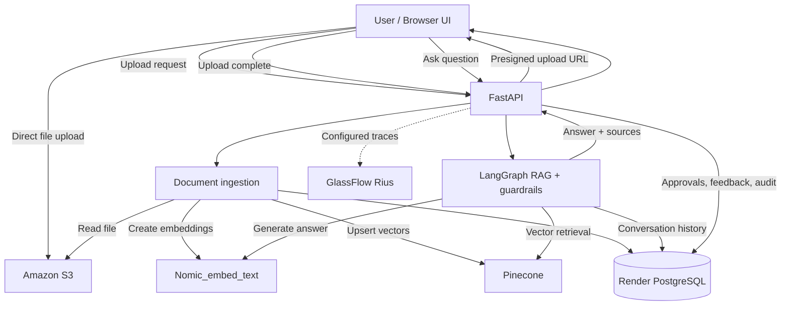
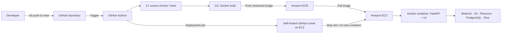

# NEXORA-AI: Enterprise Intelligence Automation Platform

NEXORA-AI is a privacy-focused enterprise intelligence platform that leverages local Large Language Models (LLMs) to automate and enhance business intelligence tasks. Built with a high-performance FastAPI backend, a Streamlit user interface, and Pinecone vector search, the platform uses local Qwen models and Nomic embeddings via Ollama to ensure complete data privacy and security without relying on external API dependencies.

**Document intelligence · Conversational memory · Guardrails · Human review · Observability · CI/CD**

[Overview](#overview) · [Architecture](#architecture) · [Quick Start](#quick-start) · [CI/CD Deployment](#cicd-deployment-to-aws) · [API](#api-reference) · [Security](#security-and-production-readiness)

## Key Features

| Capability | Description |
| --- | --- |
| Document ingestion | Browser uploads files directly to private Amazon S3 using presigned URLs; the backend processes and indexes them. |
| Enterprise RAG | Retrieve relevant chunks from Pinecone and generate grounded answers using locally installed nomic_embed_text(ollama). |
| LangGraph workflow | Coordinate retrieval, generation, guardrail checks, and conversational context. |
| Conversation memory | Persist chat turns in PostgreSQL and reuse recent history for follow-up questions. |
| Guardrails | Apply deterministic input/output checks; behavior depends on the implemented rules. |
| HITL approvals | Queue selected sensitive/action-like requests for review and record approval decisions. |
| Audit and feedback | Store relevant application events and user feedback in PostgreSQL. |
| Observability | Optional GlassFlow Rius instrumentation for supported execution traces and diagnostics. |
| Web dashboard | Document upload, chat, history, approvals, and operational views in a lightweight UI. |
| Automated delivery | Build and publish versioned Docker images to ECR and deploy to EC2 through GitHub Actions. |


## Technology Stack

| Layer | Technology | Purpose |
| --- | --- | --- |
| Backend | Python, FastAPI, Uvicorn | APIs and application server |
| Frontend | HTML, CSS, JavaScript | Browser-based user interface |
| Orchestration | LangGraph | Stateful RAG workflow |
| LLM | Amazon Bedrock — Nova Lite | Response generation |
| Embeddings | nomic_embed_text | Document and query vectors (1,024 dimensions in this project) |
| Vector database | Pinecone | Semantic retrieval and document chunk indexing |
| Object storage | Amazon S3 | Original uploaded documents |
| Relational database | PostgreSQL on Render | Document metadata, conversations, approvals, feedback, audit |
| Observability | GlassFlow Rius | Optional AI workflow tracing |
| Containerization | Docker | Portable application runtime |
| Image registry | Amazon ECR | Private Docker image storage |
| Compute | Amazon EC2 | Hosts the self-hosted runner and deployed container |
| CI/CD | GitHub Actions | Automated build, publish, and deployment |

## 📁 Repository Structure

* `app/` - FastAPI backend application, routing, and API endpoints.
* `worker/` - Document ingestion scripts and the core RAG pipeline processing.
* `docs/` - Project documentation and database schemas.
* `infra/` - Infrastructure, Docker configurations, and deployment scripts.
* `scripts/` - Utility and automation scripts.
* `Test/` - Testing modules and local LLM configuration fallbacks.

### Application architecture



> **Ingestion note:** In the reference implementation, upload completion can perform ingestion synchronously. For larger documents and production traffic, move ingestion to a durable asynchronous worker or job service.


### AWS CI/CD deployment architecture




**Deployment flow:** A commit to `main` triggers GitHub Actions. The CI job runs configured checks; the delivery job builds and pushes an image tagged with the Git commit SHA to ECR. The deployment job runs on the trusted EC2 self-hosted runner, pulls that image, and replaces the application container. The instance needs outbound access to the external services.


## Repository Structure

```text
.
├── app/
│   ├── main.py                 # FastAPI routes and UI serving
│   ├── graph.py                # LangGraph workflow
│   ├── rag.py                  # RAG integration
│   ├── vector.py               # Pinecone operations
│   ├── aws.py                  # AWS clients
│   ├── db.py                   # PostgreSQL access and audit
│   ├── memory.py               # Conversation persistence
│   ├── guardrails.py           # Input/output safety checks
│   ├── observability.py        # Rius initialization
│   ├── config.py               # Runtime configuration
│   ├── templates/              # HTML templates
│   └── static/                 # CSS and JavaScript
├── worker/
│   └── ingest.py               # File processing and indexing
├── infra/
│   └── schema.sql              # Database schema
├── scripts/
│   └── init_db.py              # Database initialization
├── docs/                       # Setup and operational notes
├── requirements.txt
├── Dockerfile
├── .env.example
└── .github/workflows/         # GitHub Actions pipelines

## 🛠️ Prerequisites

Before you begin, ensure you have the following installed on your machine:
* **Python:** Version 3.12
* **Conda:** Anaconda or Miniconda
* **Ollama:** For running local LLMs and embeddings
* **Docker:** (Optional) For containerized deployment

## ⚙️ Installation & Setup

1. **Clone the repository:**
   ```bash
   git clone [https://github.com/Ardhimahesh13/NEXORA-AI---Enterprise-Intelligence-Automation-Platform.git](https://github.com/Ardhimahesh13/NEXORA-AI---Enterprise-Intelligence-Automation-Platform.git)
   cd NEXORA-AI---Enterprise-Intelligence-Automation-Platform


## Create and activate the Conda environment
**conda create -n nexora python=3.12 -y
conda activate nexora**

## Install dependencies
**pip install -r requirements.txt**

## Start Local LLMs:
**ollama pull qwen
ollama pull nomic-embed-text**


## 💻 Running the Application
**uvicorn app.main:app --host 0.0.0.0 --port 8000 --reload**
